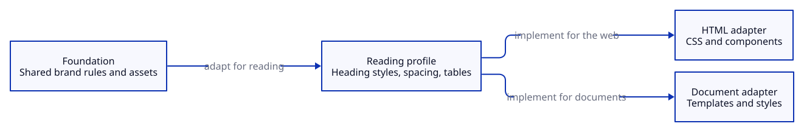

# Design-DX Convention

Working draft: `0.1.0-draft.1`.

This document defines a portable design-system package and a project that
consumes it. In this draft, **must** describes the contract; **should** describes
a recommendation. These words do not imply an external standards body's approval.
The [configuration reference](configuration.md) defines the exact draft fields.

## Design-System Package

Package paths in this section are relative to the brand package root, installed
at `.design/<brand>/` in a consuming project. `<brand>` is the filesystem-safe
brand identifier recorded in manifest `id` and project `system.path`; it is not
necessarily the brand's display name.

A package must contain:

- `manifest.json`, matching the package schema shipped with it.
- `DESIGN.md` at the package root, installed as `.design/<brand>/DESIGN.md`: the
  human/agent entry point for the shared brand design system.
- `convention/CONVENTION.md`, `convention/configuration.md`, and `convention/schemas/`, matching the declared
  Design-DX version. Reading the contract must not require a network request.
- The resources required to use every capability advertised in its manifest.
- Rights and attribution information for distributed material. Package-level
  licensing does not replace third-party asset notices.

Foundation, profile, adapter, asset, example, and validation directories are
created only when needed. Their exact paths are declared, not inferred from a
fixed taxonomy. This draft's package is one named system; composing multiple
independently versioned upstream systems is outside its scope.

The brand package's `.design/<brand>/DESIGN.md` explains purpose, authority,
usage, and boundaries. It links to
structured data and examples rather than repeating every value. It must identify
the canonical source when two representations exist, such as tokens and generated
CSS. Generated files are not independently edited sources.

## Foundations, Profiles, and Adapters

A **foundation** contains the brand's shared starting point: its logos, colors,
fonts, and rules that apply wherever the brand is used.

A **profile** explains how to use that foundation for a particular kind of work.
For example, a reading profile might define heading styles, paragraph spacing,
and tables; a touch-interface profile might define control sizes and button
states. It holds the design rules, values, and examples for that use.

An **adapter** supplies the files and instructions that apply a profile in a
particular tool or format. A web adapter might provide CSS and UI components;
a document adapter might provide a document template. The same reading profile
can have both adapters, keeping its design consistent across different outputs.

This example shows one profile with two adapters, not a required set of profiles
or an automatic build pipeline. [Editable D2 source](diagrams/design-layers.d2).

A profile's own guidance file is distinct from both the brand entry point and
project guidance. Its manifest entry determines the path, for example
`.design/<brand>/profiles/<profile>/DESIGN.md`; that filename is not required for
every profile.

Profiles may declare required profiles by ID. Expand those dependencies before
applying adapters or considering optional checks. Missing dependencies and cycles
are invalid. Multiple selected profiles have no implicit precedence. Their
combination must be explicitly supported in the system's guidance; unresolved
conflicts require a decision, not last-file-wins merging. Design-DX defines no universal
token overlay algorithm. Each adapter documents its actual merge and generation
behavior, if any.

## Consuming Project

The default consumer location is `.design/`. It contains:

- `project.json`, validated against the schema in the imported package.
- `<brand>/`, the unmodified imported brand release directory.
- Optional `.design/DESIGN.md` for project-specific guidance.
- Optional `extensions/` for project-owned additions and approved overrides.

`project.json` is authoritative for exact package selection, version, targets,
extension location, and opted-in checks. The optional `.design/DESIGN.md` explains
decisions not adequately expressed there. It must not silently contradict the
configuration. If it is absent, start with `.design/<brand>/DESIGN.md` in the
imported brand package and the selected profile/adapter entry points.

Keep `AGENTS.md` at the project/workspace root. It may point to these local files.
Project-specific skills and references can live in `.agents/`; neither that
directory nor `.design/` guarantees automatic discovery in every harness.

## Targets and Paths

A target names a coherent design context within a project and selects profiles,
adapters, and project-relative file or directory paths. A target can cover an
entire project or one surface. Adapters are optional for guidance-only use.

Package resource paths are relative to the imported package root. The system
directory and extension directory in `project.json` are relative to `.design/`.
Target paths are relative to the consuming project root, meaning the parent of
`.design/` in this draft. Use `.` to name the project root. File lists are literal
paths, not shell expressions or globs; tool-specific exclusions belong in the
tool's own configuration. Checking the same files under overlapping targets must
not silently choose one target's rules.

Paths must be portable relative paths. Do not use machine-specific absolute paths,
URLs as resource paths, parent-directory traversal, or symlinks escaping their
declared root. Schema checks can reject basic spelling mistakes; filesystem and
cross-platform checks require separate inspection. Treat paths as data, not commands.

## Project Extensions

Extensions remain outside the imported directory. They may add context-specific
components, tokens, templates, rules, or examples. Refer to upstream decisions by
stable names instead of copying their values into a second independent source.

System authors distinguish fixed requirements, overridable defaults, and extension
points. Project extensions document any departures, scope, rationale, and required
approval. Design-DX does not assign brand authority to a particular role or silently
authorize exceptions. A documented exception is not an automated compliance pass.

The mere presence of an extensions directory applies nothing. Adapters or project
integration explicitly load relevant files and document ordering. If no extension
path is declared, no extensions are assumed. If no local guidance or extensions
are needed, omit them.

## Optional Verification

Packages may ship prebuilt configurations, rules, schemas, fixtures, and optional
checker code. Each offered check documents its tool, setup, scope, invocation,
requirements, and evidence limits. Include its necessary local resources in the
package; do not leave consumers dependent on unshipped repository-only rules.

Optional capabilities can include prose checks with Vale, a component catalog
with Storybook, and browser or visual checks with Playwright. A component catalog
provides examples to inspect; it is not a passing test result. Each capability
keeps its own setup requirements, and projects choose which ones to use.

No check is enabled merely by being shipped. Projects choose whether to run any
checks and whether selected checks gate their build/review. Omitting verification
does not prevent reading, using, or extending the design system. It also does not
establish verified conformance.

A report distinguishes passed, failed, not run, and not applicable. Missing tools,
unsupported inputs, or no matching files must not become a pass. Once a project
explicitly adopts a blocking check, failure or inability to execute that check
prevents that chosen gate from passing. This does not turn other checks into gates.

Configuration never grants permission to execute code, install tools, contact
services, or modify source. Ordinary checks should be read-only and use installed
dependencies. Setup and network-dependent tasks are explicit, separate operations.

## Releases and Updates

The Design-DX version and a system's own release version are separate. This draft uses
exact version strings, not ranges or `latest`. A release's manifest and its
advertised resources must agree; record its source revision in release provenance.

Export one top-level `<brand>/` directory. A whole-system archive is the default.
If subset archives become necessary, include their transitive resources and
matching contract, narrow the manifest to what ships, and give the artifact an
unambiguous identity. Do not make consumers manually reconstruct dependencies.

Review an update before replacing the old directory. Preserve project guidance,
configuration, and extensions. Replace the imported directory rather than merging
over it and leaving deleted files behind. Retain rollback through version control
or a backup, and update the selected version deliberately. Do not overwrite local
edits in an imported copy without reconciliation. Breaking changes need migration
notes; file replacement alone cannot guarantee compatibility.

Checksums can detect accidental alteration, not establish trust when the files and
checksums can both be rewritten. Verify release origin before running imported code.

## Standards and Boundaries

Use JSON Schema Draft 2020-12 for the Design-DX configuration shapes. Bundle schemas
locally. A `$schema` annotation names a schema, not permission to fetch or execute it.

For interoperable tokens, prefer the Design Tokens Community Group format and
declare the supported revision. Verify actual converter support rather than assuming
every tool advertising DTCG handles the same revision. Design-DX schemas do not validate
token files or replace that specification. Existing native formats can remain when
their scope and conversion limits are explicit.

Design-DX does not define a visual brand, UI framework, tool runtime, mandatory CI,
universal accessibility certification, or automatic aesthetic judgment. A package
is self-contained in its design material, not necessarily in its execution runtime.
